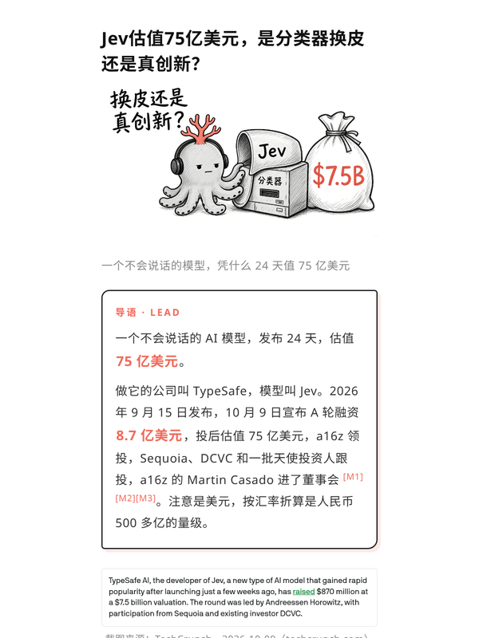
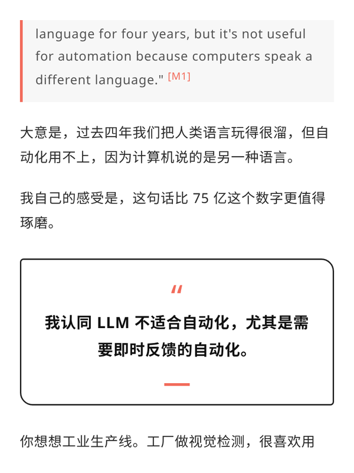
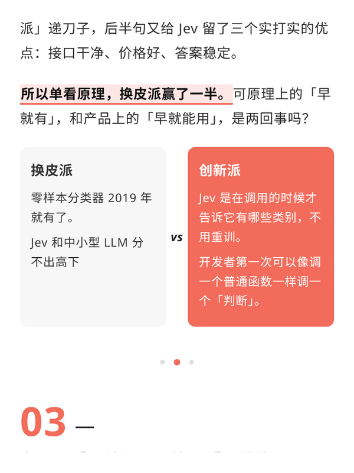
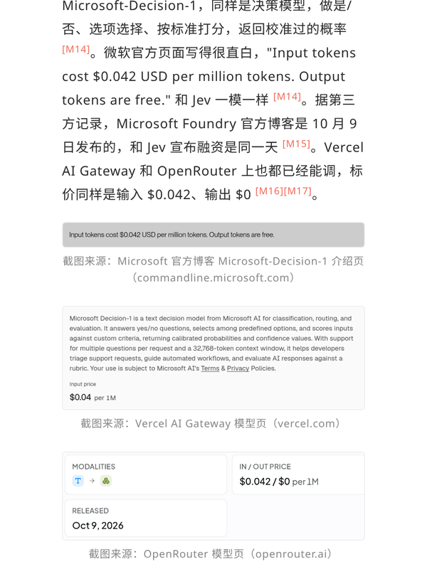
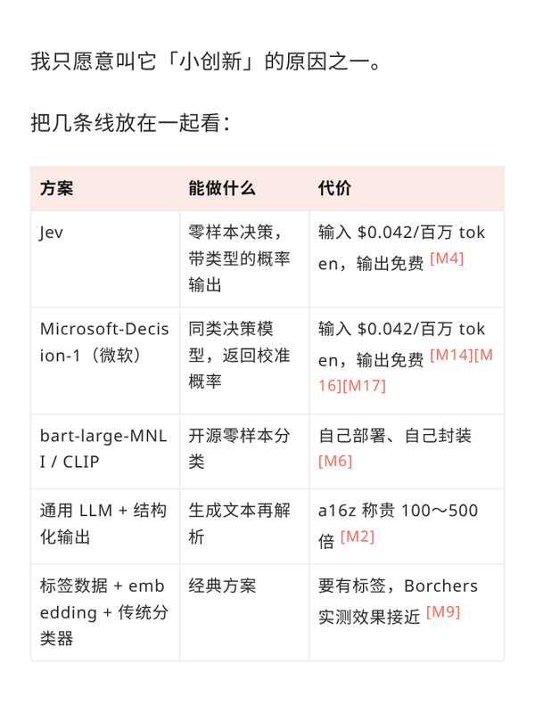
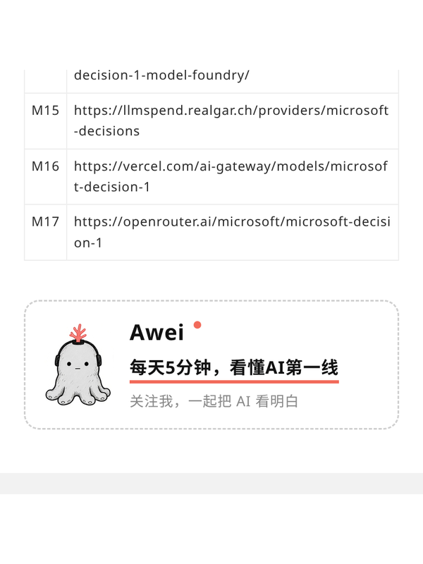
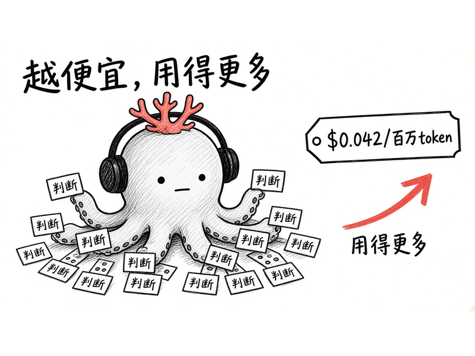
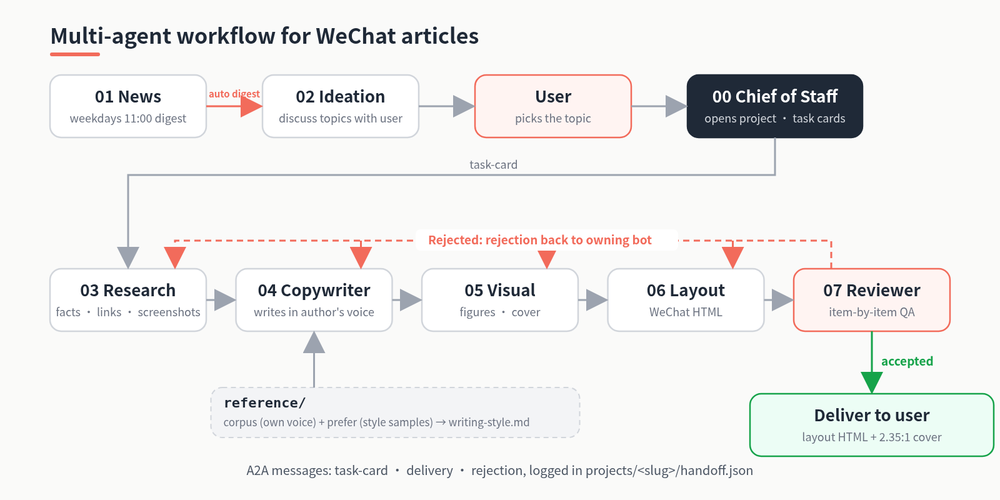

# gzh-article-group

[中文](README.md) | English

**Give it a topic, get back a WeChat article ready to paste.**

- Topic to finished piece: one topic in, laid-out HTML plus a cover out
- 8 bots with fixed jobs: news, ideation, research, copy, visuals, layout, review, plus a chief of staff; each builds up its own experience
- Primary sources + screenshot citations: every fact is sourced; if it can't be found, it says so instead of making it up
- Learns your own voice: feed it your articles, diaries and comments, plus styles you like (form only, never others' viewpoints)
- Consistent visuals: design your own IP character at setup (or go without), with matching cover and illustrations
- WeChat-compatible layout master: fully inline styles, end card built in code so it adapts to width
- Reviewer gate: screenshots, copy, visuals and layout checked item by item; failures go back to the owning bot
- One-line install for any agent: Codex, Claude Code, Cursor, Hermes, OpenClaw and more

## Showcase
<table>
<tr>
<td align="center" width="33%"><br><sub>Title and lead card</sub></td>
<td align="center" width="33%"><br><sub>Pull quote and highlighted sentence</sub></td>
<td align="center" width="33%"><br><sub>Compare cards</sub></td>
</tr>
<tr>
<td align="center" width="33%"><br><sub>Screenshot citations</sub></td>
<td align="center" width="33%"><br><sub>Comparison table</sub></td>
<td align="center" width="33%"><br><sub>References and coded end card</sub></td>
</tr>
</table>

Illustration example:

<p align="center"><br><sub>Jevons paradox figure</sub></p>

> Note: the grey octopus in the showcase and the Jev example project is the author's own IP, shown for demo only. **It is not included in the default configs; please don't reuse it.** After install, gzh-init helps you design your own IP, or skip it.

## One-line install
Send this to your agent (Codex, Claude Code, Cursor, Hermes, OpenClaw, etc.):

```text
Install https://github.com/Designer-Awei/gzh-article-group. Read AGENTS.md in the repo, detect your current environment and pick the best install method. Then run the initialization (gzh-init): ask me for writing samples to build my writing style, then ask about my account positioning and suggest an IP character. I may skip any step; use the defaults if I do.
```

## Flow
<p align="center"></p>


If the reviewer rejects, it sends a rejection to the owning role, which reworks and is reviewed again. Once everything passes, the chief of staff delivers exactly two things: the WeChat-ready HTML in `layout/` and the 2.35:1 cover in `cover/`.

## Run modes
| Mode | For | How |
|---|---|---|
| **Single agent (default, recommended)** | Most people | One agent mounts `bots/*/SKILL.md` and plays each role in turn; handoffs are files in `projects/<slug>/`, logged in `handoff.json` |
| Multi-agent + A2A (optional) | Running roles independently, in parallel or across platforms | One agent per role, registered via `agent-card.json`, messaging per `protocol/`, still writing `handoff.json` |

Note: the reference implementation ran as several bots on a host platform, coordinating through that platform's built-in agent messaging, not a deployed A2A service. `agent-card.json` and `protocol/` are conventions shaped after the A2A spec for anyone who wants to wire it up.

## Layout
```
gzh-article-group/
├── AGENTS.md  CONVENTIONS.md  README.md  README.en.md  LICENSE  .gitignore
├── bots/
│   ├── 00-chief-of-staff/   SKILL.md spec.md agent-card.json config/ init/SKILL.md
│   ├── 01-news/             … config/news-sources.example.md
│   ├── 02-ideation/
│   ├── 03-research/
│   ├── 04-copywriter/
│   ├── 05-visual/           … config/visual-style.md config/ip/
│   ├── 06-layout/           … config/master/ config/styles/
│   └── 07-reviewer/         … config/checklist.md
├── projects/
│   ├── README.md  _template/
│   └── 2026-10-12-jev-valuation/
│       ├── handoff.json  brief/ source/ draft/ illustration/ cover/ layout/ review/
├── reference/               README.md writing-style.template.md corpus/{articles,links,notes,imgs}/ prefer/{links,articles,imgs}/
├── protocol/                task-card / delivery / rejection / handoff schemas + examples/
├── scripts/new-project.py
└── docs/                    INIT.md showcase/
```
Agents should read [AGENTS.md](AGENTS.md), [CONVENTIONS.md](CONVENTIONS.md) and [projects/README.md](projects/README.md) first.

## Roles
| Directory | Role | Responsibility |
|---|---|---|
| [00-chief-of-staff](bots/00-chief-of-staff/SKILL.md) | Chief of Staff | Orchestrator and user entry: dispatches task cards, batches questions, delivers HTML + cover |
| [01-news](bots/01-news/SKILL.md) | News Scout | Sends a weekday 11:00 AI digest and auto-forwards it to Ideation |
| [02-ideation](bots/02-ideation/SKILL.md) | Ideation Partner | Pre-drafts 2–3 angles from the digest and waits for you; turns brain-dumps into sharp topics |
| [03-research](bots/03-research/SKILL.md) | Researcher | Collects verifiable facts and screenshots |
| [04-copywriter](bots/04-copywriter/SKILL.md) | Copywriter | Writes the draft in the author's voice |
| [05-visual](bots/05-visual/SKILL.md) | Visual Designer | Produces on-brand cover and figures |
| [06-layout](bots/06-layout/SKILL.md) | Layout Designer | Lays out WeChat-ready HTML from draft, figures and screenshots |
| [07-reviewer](bots/07-reviewer/SKILL.md) | Reviewer | Final QA gate; rejects back to the owning role |

## A2A message example (optional)
The reviewer rejects the layout role ([rejection.schema.json](protocol/rejection.schema.json)):
```json
{
  "type": "rejection",
  "id": "rj-002",
  "project": "2026-10-12-jev-valuation",
  "from": "07-reviewer",
  "to": "06-layout",
  "item": "layout",
  "issues": [
    {
      "location": "projects/2026-10-12-jev-valuation/layout/ 文末卡片",
      "problem": "粘贴进公众号后头像图被放大",
      "expected": "img 写死 width 属性并缩小原图"
    }
  ]
}
```
See [protocol/README.md](protocol/README.md) for all three messages.

## Quick start
1. **Initialize**: have an agent run [bots/00-chief-of-staff/init/SKILL.md](bots/00-chief-of-staff/init/SKILL.md); checklist in [docs/INIT.md](docs/INIT.md). Step 1 uploads your own corpus (plus optional liked samples) to build `reference/writing-style.md` (skippable, defaults to [khazix-writer](https://github.com/KKKKhazix/khazix-skills/tree/main/khazix-writer)); step 2 the visual role proposes an IP character matching your account positioning (skippable).
2. **Start an article**: `python3 scripts/new-project.py 2026-10-20-my-topic` creates the fixed layout and `handoff.json` from `projects/_template/`.
3. **Load roles**: follow the self-install guide in [AGENTS.md](AGENTS.md) (skills directory, rules file, or no install at all: read `bots/*/SKILL.md` in place). Check each tool's own docs for exact paths.

## End-to-end example

The full output of the Jev article ("Jev at a $7.5B valuation: a reskinned classifier or real innovation?"), from topic, sources, draft, figures and cover to layout, review and handoff log, is in [projects/2026-10-12-jev-valuation/](projects/2026-10-12-jev-valuation/).

## Acknowledgements

This workflow was inspired by the "bot army" post shared on X by [@Jackywxsz](https://x.com/Jackywxsz): https://x.com/Jackywxsz/status/2108808842045956343

## License
[MIT](LICENSE)
