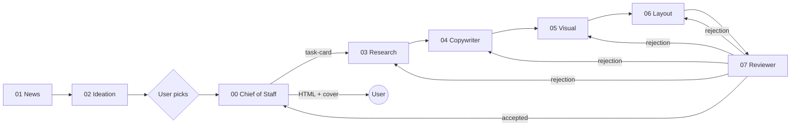

# gzh-article-group

[中文](README.md) | English

A **multi-agent workflow for WeChat Official Account (公众号) articles**, built to be loaded directly by agents such as Codex, Cursor, Hermes and OpenClaw. Each role is a subagent loaded with a fixed skill/spec, and roles talk via the A2A (Agent2Agent) protocol using three messages: task card, delivery, rejection. Responsibilities are fixed, so experience accumulates in each role's `config/` and `projects/`.


## Flow


If the reviewer rejects, it sends a rejection to the owning role, which reworks and is reviewed again. Once everything passes, the chief of staff delivers exactly two things to the user: WeChat-ready layout HTML and a 2.35:1 cover.

## Layout
```
gzh-article-group/
├── AGENTS.md  CONVENTIONS.md  LICENSE  README.md  README.en.md
├── 00-chief-of-staff/   SKILL.md  spec.md  agent-card.json  config/  projects/
├── 01-news/             … config/news-sources.example.md
├── 02-ideation/
├── 03-research/
├── 04-copywriter/       … config/writing-style-outline.md
├── 05-visual/           … config/visual-style.md  config/ip/
├── 06-layout/           … config/master/  config/styles/
├── 07-reviewer/         … config/checklist.md
├── protocol/            task-card / delivery / rejection / handoff schemas + examples/
├── templates/project/
├── scripts/new-project.py
└── docs/showcase/
```
Agents should read [AGENTS.md](AGENTS.md) and [CONVENTIONS.md](CONVENTIONS.md) first.

## Roles
| Directory | Role | Responsibility |
|---|---|---|
| [00-chief-of-staff](00-chief-of-staff/SKILL.md) | Chief of Staff | Orchestrator and user entry: dispatches task cards, batches questions, delivers HTML + cover |
| [01-news](01-news/SKILL.md) | News Scout | Builds a weekday AI news digest |
| [02-ideation](02-ideation/SKILL.md) | Ideation Partner | Turns brain-dumps into sharp topics through questioning |
| [03-research](03-research/SKILL.md) | Researcher | Collects verifiable facts and screenshots |
| [04-copywriter](04-copywriter/SKILL.md) | Copywriter | Writes the draft in the author's voice |
| [05-visual](05-visual/SKILL.md) | Visual Designer | Produces on-brand cover and figures |
| [06-layout](06-layout/SKILL.md) | Layout Designer | Lays out WeChat-ready HTML from draft, figures and screenshots |
| [07-reviewer](07-reviewer/SKILL.md) | Reviewer | Final QA gate; rejects back to the owning role |

## A2A message example
The reviewer rejects the layout role ([rejection.schema.json](protocol/rejection.schema.json)):
```json
{
  "type": "rejection",
  "id": "rj-001",
  "project": "2026-10-12-jev-valuation",
  "from": "07-reviewer",
  "to": "06-layout",
  "item": "layout",
  "issues": [
    {
      "location": "文末卡片",
      "problem": "粘贴进公众号后章鱼图被放大",
      "expected": "img 写死 width 属性并缩小原图"
    }
  ]
}
```
See [protocol/README.md](protocol/README.md) for all three messages.

## Quick start
1. Start an article: `python3 scripts/new-project.py 2026-10-20-my-topic` creates the same project folder under all 8 role directories and initialises `handoff.json`.
2. Replace configs as needed: `01-news/config/news-sources.example.md`, `04-copywriter/config/writing-style-outline.md`, `05-visual/config/visual-style.md`.
3. Load a role (copywriter as example):
- **Codex**: run it at the repo root; Codex reads `AGENTS.md` automatically. Then prompt "act as the copywriter per `04-copywriter/SKILL.md` for project `<slug>`". Or copy `04-copywriter/` to `~/.codex/skills/gzh-copywriter/` to load it as a skill.
- **Cursor**: open the repo and add `.cursor/rules/copywriter.mdc` that references `@04-copywriter/SKILL.md` and `@AGENTS.md`; or simply `@04-copywriter/SKILL.md` in Chat and give the task.
- **Hermes**: copy `04-copywriter/` into Hermes' skills directory (e.g. `~/.hermes/skills/gzh-copywriter/`); the SKILL.md frontmatter provides the skill name and description.
- **OpenClaw**: put `04-copywriter/` into the workspace `skills/` folder (e.g. `~/.openclaw/skills/gzh-copywriter/`), restart the session, and invoke it as `gzh-copywriter`.

## Showcase
| Snippet | Description |
|---|---|
|  | Title and lead card |
|  | Pull quote and highlighted sentence |
|  | Compare cards |
|  | Screenshot citations |
|  | Comparison table |
|  | References and coded end card |

The "grey octopus" mascot and an illustration:


## End-to-end example: Jev at a $7.5B valuation — a reskinned classifier or real innovation?
Project slug: `2026-10-12-jev-valuation`
1. [02-ideation](02-ideation/projects/2026-10-12-jev-valuation/topic.md) — Topic brief: stance "a small innovation"
2. [03-research](03-research/projects/2026-10-12-jev-valuation/materials.md) — Research pack (M-numbered, linked)
3. [04-copywriter](04-copywriter/projects/2026-10-12-jev-valuation/draft.md) — Draft excerpt
4. [05-visual](05-visual/projects/2026-10-12-jev-valuation/cover-2.35.jpg) — 2.35:1 cover and figure
5. [06-layout](06-layout/projects/2026-10-12-jev-valuation/README.md) — Layout snippets
6. [07-reviewer](07-reviewer/projects/2026-10-12-jev-valuation/review-report.md) — Review report with rejections
7. [00-chief-of-staff](00-chief-of-staff/projects/2026-10-12-jev-valuation/delivery.md) — Delivery list

## License
[MIT](LICENSE)
