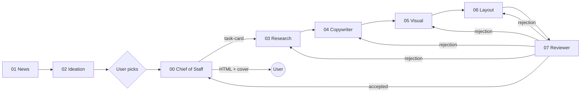

# gzh-article-group

[中文](README.md) | English

A **multi-agent workflow for WeChat Official Account (公众号) articles**, built to be loaded directly by agents such as Codex, Cursor, Hermes and OpenClaw. Each role in `bots/` is a subagent loaded with a fixed skill/spec, and roles talk over the A2A (Agent2Agent) protocol with three messages: task card, delivery, rejection. Each article lives in one `projects/<slug>/` folder with a fixed layout; the author's corpus and writing style live in `reference/`.


## Flow


If the reviewer rejects, it sends a rejection to the owning role, which reworks and is reviewed again. Once everything passes, the chief of staff delivers exactly two things: the WeChat-ready HTML in `layout/` and the 2.35:1 cover in `cover/`.

## Layout
```
gzh-article-group/
├── AGENTS.md  CONVENTIONS.md  README.md  README.en.md  LICENSE  .gitignore
├── bots/
│   ├── 00-chief-of-staff/   SKILL.md spec.md agent-card.json config/ init/SKILL.md
│   ├── 01-news/             … config/news-sources.example.md
│   ├── 02-ideation/
│   ├── 03-research/
│   ├── 04-copywriter/
│   ├── 05-visual/           … config/visual-style.md config/ip/
│   ├── 06-layout/           … config/master/ config/styles/
│   └── 07-reviewer/         … config/checklist.md
├── projects/
│   ├── README.md  _template/
│   └── 2026-10-12-jev-valuation/
│       ├── handoff.json  brief/ source/ draft/ illustration/ cover/ layout/ review/
├── reference/               README.md writing-style.template.md corpus/{articles,links,notes}/
├── protocol/                task-card / delivery / rejection / handoff schemas + examples/
├── scripts/new-project.py
└── docs/                    INIT.md showcase/
```
Agents should read [AGENTS.md](AGENTS.md), [CONVENTIONS.md](CONVENTIONS.md) and [projects/README.md](projects/README.md) first.

## Roles
| Directory | Role | Responsibility |
|---|---|---|
| [00-chief-of-staff](bots/00-chief-of-staff/SKILL.md) | Chief of Staff | Orchestrator and user entry: dispatches task cards, batches questions, delivers HTML + cover |
| [01-news](bots/01-news/SKILL.md) | News Scout | Builds a weekday AI news digest |
| [02-ideation](bots/02-ideation/SKILL.md) | Ideation Partner | Turns brain-dumps into sharp topics through questioning |
| [03-research](bots/03-research/SKILL.md) | Researcher | Collects verifiable facts and screenshots |
| [04-copywriter](bots/04-copywriter/SKILL.md) | Copywriter | Writes the draft in the author's voice |
| [05-visual](bots/05-visual/SKILL.md) | Visual Designer | Produces on-brand cover and figures |
| [06-layout](bots/06-layout/SKILL.md) | Layout Designer | Lays out WeChat-ready HTML from draft, figures and screenshots |
| [07-reviewer](bots/07-reviewer/SKILL.md) | Reviewer | Final QA gate; rejects back to the owning role |

## A2A message example
The reviewer rejects the layout role ([rejection.schema.json](protocol/rejection.schema.json)):
```json
{
  "type": "rejection",
  "id": "rj-002",
  "project": "2026-10-12-jev-valuation",
  "from": "07-reviewer",
  "to": "06-layout",
  "item": "layout",
  "issues": [
    {
      "location": "projects/2026-10-12-jev-valuation/layout/ 文末卡片",
      "problem": "粘贴进公众号后章鱼图被放大",
      "expected": "img 写死 width 属性并缩小原图"
    }
  ]
}
```
See [protocol/README.md](protocol/README.md) for all three messages.

## Quick start
1. **Initialize**: have an agent run [bots/00-chief-of-staff/init/SKILL.md](bots/00-chief-of-staff/init/SKILL.md); checklist in [docs/INIT.md](docs/INIT.md). Step 1 uploads your corpus to build `reference/writing-style.md` (skippable, defaults to [khazix-writer](https://github.com/KKKKhazix/khazix-skills/tree/main/khazix-writer)); step 2 the visual role proposes an IP character matching your account positioning (skippable).
2. **Start an article**: `python3 scripts/new-project.py 2026-10-20-my-topic` creates the fixed layout and `handoff.json` from `projects/_template/`.
3. **Load a role** (copywriter as example):
- **Codex**: run at the repo root; Codex reads `AGENTS.md` automatically. Prompt "act as the copywriter per `bots/04-copywriter/SKILL.md` for `projects/<slug>`". Or copy `bots/04-copywriter/` to `~/.codex/skills/gzh-copywriter/` to load it as a skill.
- **Cursor**: open the repo and add `.cursor/rules/copywriter.mdc` referencing `@bots/04-copywriter/SKILL.md` and `@AGENTS.md`; or just `@bots/04-copywriter/SKILL.md` in Chat.
- **Hermes**: copy `bots/04-copywriter/` into Hermes' skills directory (e.g. `~/.hermes/skills/gzh-copywriter/`); the SKILL.md frontmatter supplies name and description.
- **OpenClaw**: put `bots/04-copywriter/` into OpenClaw's skills directory (e.g. `~/.openclaw/skills/gzh-copywriter/`), restart the session, and invoke `gzh-copywriter`.

## Showcase
| Snippet | Description |
|---|---|
|  | Title and lead card |
|  | Pull quote and highlighted sentence |
|  | Compare cards |
|  | Screenshot citations |
|  | Comparison table |
|  | References and coded end card |

The "grey octopus" mascot and an illustration:


## End-to-end example: Jev at a $7.5B valuation — a reskinned classifier or real innovation?
Project: [projects/2026-10-12-jev-valuation](projects/2026-10-12-jev-valuation/README.md)
1. [brief/topic.md](projects/2026-10-12-jev-valuation/brief/topic.md) · `02-ideation` · Topic brief: stance "a small innovation"
2. [source/materials.md](projects/2026-10-12-jev-valuation/source/materials.md) · `03-research` · Research pack (M-numbered, linked)
3. [draft/draft.md](projects/2026-10-12-jev-valuation/draft/draft.md) · `04-copywriter` · Draft excerpt
4. [illustration/fig-jevons-paradox.jpg](projects/2026-10-12-jev-valuation/illustration/fig-jevons-paradox.jpg) · `05-visual` · Figure
5. [cover/cover-2.35.jpg](projects/2026-10-12-jev-valuation/cover/cover-2.35.jpg) · `05-visual` · 2.35:1 cover
6. [layout/README.md](projects/2026-10-12-jev-valuation/layout/README.md) · `06-layout` · Layout snippets
7. [review/review-report.md](projects/2026-10-12-jev-valuation/review/review-report.md) · `07-reviewer` · Review report with rejections
8. [handoff.json](projects/2026-10-12-jev-valuation/handoff.json) · `all` · A2A handoff log (incl. 2 rejections)

## License
[MIT](LICENSE)
