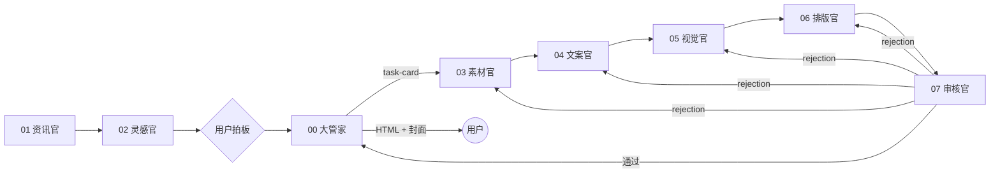

# gzh-article-group

中文 | [English](README.en.md)

一套**公众号文章多智能体工作流**，给 Codex、Cursor、Hermes、OpenClaw 等智能体直接装载使用。`bots/` 里每个角色就是一个装载了固定 skill/spec 的 subagent，角色之间按 A2A（Agent2Agent）协议用三种消息通信：任务卡、交付、打回。一篇文章一个 `projects/<slug>/` 文件夹，结构固定；作者的写作风格沉淀在 `reference/`：`corpus/` 是本人语料（观点和声音的来源，权重最高），`prefer/` 是喜欢的第三方风格样本（只借鉴结构、节奏、钩子，不抄观点）。随时把链接或截图丢给任意 bot，它会归档并触发风格刷新。

## 流程
<p align="center"></p>

<details>
<summary>mermaid 文本版</summary>



</details>

审核官不通过就用 rejection 打回负责角色，返工后重新验收；全部通过后，大管家只向用户交付两样：`layout/` 里可直接粘贴进公众号的 HTML，和 `cover/` 里的 2.35:1 封面。

## 目录
```
gzh-article-group/
├── AGENTS.md  CONVENTIONS.md  README.md  README.en.md  LICENSE  .gitignore
├── bots/
│   ├── 00-chief-of-staff/   SKILL.md spec.md agent-card.json config/ init/SKILL.md
│   ├── 01-news/             … config/news-sources.example.md
│   ├── 02-ideation/
│   ├── 03-research/
│   ├── 04-copywriter/
│   ├── 05-visual/           … config/visual-style.md config/ip/
│   ├── 06-layout/           … config/master/ config/styles/
│   └── 07-reviewer/         … config/checklist.md
├── projects/
│   ├── README.md  _template/
│   └── 2026-10-12-jev-valuation/
│       ├── handoff.json  brief/ source/ draft/ illustration/ cover/ layout/ review/
├── reference/               README.md writing-style.template.md corpus/{articles,links,notes,imgs}/ prefer/{links,articles,imgs}/
├── protocol/                task-card / delivery / rejection / handoff schemas + examples/
├── scripts/new-project.py
└── docs/                    INIT.md showcase/
```
智能体请先读 [AGENTS.md](AGENTS.md)、[CONVENTIONS.md](CONVENTIONS.md) 和 [projects/README.md](projects/README.md)。

## 角色
| 目录 | 角色 | 职责 |
|---|---|---|
| [00-chief-of-staff](bots/00-chief-of-staff/SKILL.md) | 大管家 | 编排者与用户主入口：派任务卡、汇总问题、交付 HTML + 封面 |
| [01-news](bots/01-news/SKILL.md) | 资讯官 | 每个工作日整理 AI 热点早报 |
| [02-ideation](bots/02-ideation/SKILL.md) | 灵感官 | 接住口喷、追问深挖、收敛成选题 |
| [03-research](bots/03-research/SKILL.md) | 素材官 | 为选题搜集可核实素材与截图 |
| [04-copywriter](bots/04-copywriter/SKILL.md) | 文案官 | 按作者风格写成稿 |
| [05-visual](bots/05-visual/SKILL.md) | 视觉官 | 出风格统一的封面与配图 |
| [06-layout](bots/06-layout/SKILL.md) | 排版官 | 把定稿、配图、截图排成可粘贴进公众号的 HTML |
| [07-reviewer](bots/07-reviewer/SKILL.md) | 审核官 | 交付前最终验收，不过就打回 |

## A2A 消息示例
审核官打回排版官（[rejection.schema.json](protocol/rejection.schema.json)）：
```json
{
  "type": "rejection",
  "id": "rj-002",
  "project": "2026-10-12-jev-valuation",
  "from": "07-reviewer",
  "to": "06-layout",
  "item": "layout",
  "issues": [
    {
      "location": "projects/2026-10-12-jev-valuation/layout/ 文末卡片",
      "problem": "粘贴进公众号后章鱼图被放大",
      "expected": "img 写死 width 属性并缩小原图"
    }
  ]
}
```
三种消息说明见 [protocol/README.md](protocol/README.md)。

## 快速开始
1. **初始化**：让智能体执行 [bots/00-chief-of-staff/init/SKILL.md](bots/00-chief-of-staff/init/SKILL.md)，清单见 [docs/INIT.md](docs/INIT.md)。第 1 步上传本人语料（及可选的偏好样本）生成 `reference/writing-style.md`（可跳过，默认用 [khazix-writer](https://github.com/KKKKhazix/khazix-skills/tree/main/khazix-writer)）；第 2 步视觉官按账号定位建议 IP 形象（可跳过）。
2. **开新文章**：`python3 scripts/new-project.py 2026-10-20-my-topic`，从 `projects/_template/` 生成固定结构和 `handoff.json`。
3. **装载角色**（以文案官为例）：
- **Codex**：在仓库根目录运行，Codex 自动读取 `AGENTS.md`；提示「按 `bots/04-copywriter/SKILL.md` 担任文案官，处理 `projects/<slug>`」。也可把 `bots/04-copywriter/` 复制到 `~/.codex/skills/gzh-copywriter/` 作为 skill 加载。
- **Cursor**：打开仓库，新建 `.cursor/rules/copywriter.mdc` 引用 `@bots/04-copywriter/SKILL.md` 与 `@AGENTS.md`；或在 Chat 中直接 `@bots/04-copywriter/SKILL.md` 后下达任务。
- **Hermes**：把 `bots/04-copywriter/` 复制到 Hermes 的 skills 目录（如 `~/.hermes/skills/gzh-copywriter/`），SKILL.md 的 frontmatter 即技能名与描述。
- **OpenClaw**：把 `bots/04-copywriter/` 放进 OpenClaw 的 skills 目录（如 `~/.openclaw/skills/gzh-copywriter/`），重启会话后按 `gzh-copywriter` 调用。

## 展示
<table>
<tr>
<td align="center" width="33%"><br><sub>标题与导语卡</sub></td>
<td align="center" width="33%"><br><sub>金句卡与重点句高亮</sub></td>
<td align="center" width="33%"><br><sub>对比卡</sub></td>
</tr>
<tr>
<td align="center" width="33%"><br><sub>截图引用与来源标注</sub></td>
<td align="center" width="33%"><br><sub>对比表</sub></td>
<td align="center" width="33%"><br><sub>引用清单与代码排版文末卡片</sub></td>
</tr>
</table>

IP 形象「灰章鱼」与配图：

<table>
<tr>
<td align="center" width="50%"><br><sub>灰章鱼 IP</sub></td>
<td align="center" width="50%"><br><sub>杰文斯悖论配图</sub></td>
</tr>
</table>

## 全链路示例：Jev 估值 75 亿美元，是分类器换皮还是真创新？
项目：[projects/2026-10-12-jev-valuation](projects/2026-10-12-jev-valuation/README.md)
1. [brief/topic.md](projects/2026-10-12-jev-valuation/brief/topic.md) · `02-ideation` · 选题总结：核心观点「小创新」
2. [source/materials.md](projects/2026-10-12-jev-valuation/source/materials.md) · `03-research` · 素材包（M1… 编号、带链接）
3. [draft/draft.md](projects/2026-10-12-jev-valuation/draft/draft.md) · `04-copywriter` · 定稿片段
4. [illustration/fig-jevons-paradox.jpg](projects/2026-10-12-jev-valuation/illustration/fig-jevons-paradox.jpg) · `05-visual` · 正文配图
5. [cover/cover-2.35.jpg](projects/2026-10-12-jev-valuation/cover/cover-2.35.jpg) · `05-visual` · 2.35:1 封面
6. [layout/README.md](projects/2026-10-12-jev-valuation/layout/README.md) · `06-layout` · 排版片段
7. [review/review-report.md](projects/2026-10-12-jev-valuation/review/review-report.md) · `07-reviewer` · 验收报告（含打回记录）
8. [handoff.json](projects/2026-10-12-jev-valuation/handoff.json) · `all` · A2A 流转日志（含 2 次打回）

## 致谢

本工作流的灵感来自 [@Jackywxsz](https://x.com/Jackywxsz) 在 X 上分享的「bot 军团」帖子：https://x.com/Jackywxsz/status/2108808842045956343

## 许可
[MIT](LICENSE)
