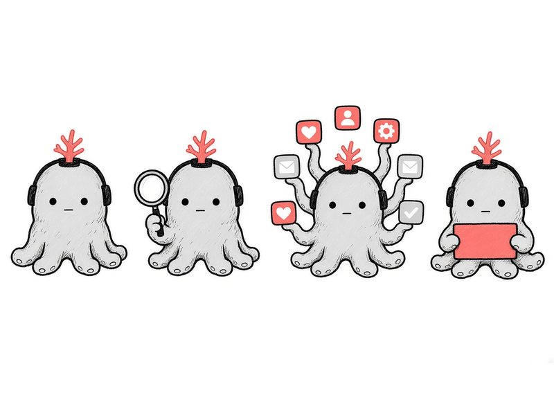
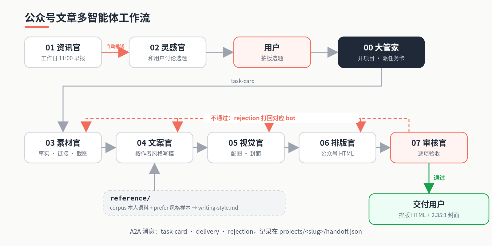

# gzh-article-group

中文 | [English](README.en.md)

**说一句选题，拿到一篇能直接粘进公众号的成品。**

- 从选题到成品：一句选题进去，出来排好版的 HTML 和一张封面
- 8 个 bot 固定分工：资讯、灵感、素材、文案、视觉、排版、审核、大管家，经验各自积累
- 一手素材 + 截图引证：每个事实都带出处，查不到就如实写，不编造
- 学你自己的文风：投喂你的文章、日记、评论，也能喂你喜欢的别人的写法（只学形式，不抄观点）
- 统一视觉：初始化时设计你自己的 IP 形象（也可以不用），封面和配图风格一致
- 微信兼容排版母版库：4 套结构不同的母版（珊瑚默认 / 窗口终端 / 杂志特稿 / 时间线票根），按选题挑，见 [styles/INDEX.md](bots/06-layout/config/styles/INDEX.md)；全内联样式，共用一张代码排的文末签名卡
- 审核官把关：截图、文稿、配图、排版逐项验收，不合格直接打回对应 bot
- 任意智能体一键安装：Codex、Claude Code、Cursor、Hermes、OpenClaw 等都能用

## 展示
<table>
<tr>
<td align="center" width="33%"><br><sub>标题与导语卡</sub></td>
<td align="center" width="33%"><br><sub>金句卡与重点句高亮</sub></td>
<td align="center" width="33%"><br><sub>对比卡</sub></td>
</tr>
<tr>
<td align="center" width="33%"><br><sub>截图引用与来源标注</sub></td>
<td align="center" width="33%"><br><sub>对比表</sub></td>
<td align="center" width="33%"><br><sub>引用清单与代码排版文末卡片</sub></td>
</tr>
</table>

IP 形象与配图示例：

<table>
<tr>
<td align="center" width="50%"><br><sub>灰章鱼 IP（作者自有，仅演示）</sub></td>
<td align="center" width="50%"><br><sub>杰文斯悖论配图</sub></td>
</tr>
</table>

> 注：展示图和 Jev 示例项目里出现的灰章鱼是作者本人的 IP，仅作演示，**不包含在仓库的默认配置里，请勿复用**。安装后 gzh-init 会帮你设计自己的 IP，或选择不用 IP。

## 一键安装
**前提**：你的智能体需要自带生图能力，或者你自己配置一个生图 API（环境变量 `IMAGE_API_KEY` / `IMAGE_API_BASE` / `IMAGE_MODEL`，可选服务见 [image-gen.md](bots/05-visual/config/image-gen.md)），否则视觉官无法出封面和配图。

把下面这段话发给你的智能体（Codex、Claude Code、Cursor、Hermes、OpenClaw 等）：

```text
请安装 https://github.com/Designer-Awei/gzh-article-group 。先阅读仓库里的 AGENTS.md，判断你当前的运行环境，选择最合适的安装方式；安装完成后运行初始化（gzh-init）：向我索取写作语料来生成我的写作风格，再问我的账号定位并建议 IP 形象。每一步我都可以跳过，跳过就用默认设置。
```

## 流程
<p align="center"></p>


审核官不通过就用 rejection 打回负责角色，返工后重新验收；全部通过后，大管家只向用户交付两样：`layout/` 里可直接粘贴进公众号的 HTML，和 `cover/` 里的 2.35:1 封面。

## 运行模式
| 模式 | 适合 | 怎么跑 |
|---|---|---|
| **单智能体（默认、推荐）** | 绝大多数人 | 一个智能体挂载 `bots/*/SKILL.md`，按流程依次扮演各角色；交接靠 `projects/<slug>/` 里的文件，并在 `handoff.json` 记录 |
| 多智能体 + A2A（可选） | 想让角色各自独立运行、并行或跨平台 | 每个角色一个智能体，用 `agent-card.json` 注册，按 `protocol/` 的消息格式通信，同样写 `handoff.json` |

说明：本仓库的参考实现是在宿主平台上用多个 bot 通过平台自带的智能体消息协作完成的，并没有部署 A2A 服务；`agent-card.json` 和 `protocol/` 是按 A2A 规范整理的约定，供需要的人对接。

## 目录
```
gzh-article-group/
├── AGENTS.md  CONVENTIONS.md  README.md  README.en.md  LICENSE  .gitignore
├── bots/
│   ├── 00-chief-of-staff/   SKILL.md spec.md agent-card.json config/ init/SKILL.md
│   ├── 01-news/             … config/news-sources.example.md
│   ├── 02-ideation/
│   ├── 03-research/
│   ├── 04-copywriter/
│   ├── 05-visual/           … config/visual-style.md config/ip/
│   ├── 06-layout/           … config/master/ config/styles/
│   └── 07-reviewer/         … config/checklist.md
├── projects/
│   ├── README.md  _template/
│   └── 2026-10-12-jev-valuation/
│       ├── handoff.json  brief/ source/ draft/ illustration/ cover/ layout/ review/
├── reference/               README.md writing-style.template.md corpus/{articles,links,notes,imgs}/ prefer/{links,articles,imgs}/
├── protocol/                task-card / delivery / rejection / handoff schemas + examples/
├── scripts/new-project.py
└── docs/                    INIT.md showcase/
```
智能体请先读 [AGENTS.md](AGENTS.md)、[CONVENTIONS.md](CONVENTIONS.md) 和 [projects/README.md](projects/README.md)。

## 角色
| 目录 | 角色 | 职责 |
|---|---|---|
| [00-chief-of-staff](bots/00-chief-of-staff/SKILL.md) | 大管家 | 编排者与用户主入口：派任务卡、汇总问题、交付 HTML + 封面 |
| [01-news](bots/01-news/SKILL.md) | 资讯官 | 每个工作日 11:00 发 AI 热点早报，并自动推送给灵感官 |
| [02-ideation](bots/02-ideation/SKILL.md) | 灵感官 | 收到早报先备好 2–3 个角度，等你来聊；接住口喷、追问深挖、收敛成选题 |
| [03-research](bots/03-research/SKILL.md) | 素材官 | 为选题搜集可核实素材与截图 |
| [04-copywriter](bots/04-copywriter/SKILL.md) | 文案官 | 按作者风格写成稿 |
| [05-visual](bots/05-visual/SKILL.md) | 视觉官 | 出风格统一的封面与配图 |
| [06-layout](bots/06-layout/SKILL.md) | 排版官 | 把定稿、配图、截图排成可粘贴进公众号的 HTML |
| [07-reviewer](bots/07-reviewer/SKILL.md) | 审核官 | 交付前最终验收，不过就打回 |

## A2A 消息示例（可选）
审核官打回排版官（[rejection.schema.json](protocol/rejection.schema.json)）：
```json
{
  "type": "rejection",
  "id": "rj-002",
  "project": "2026-10-12-jev-valuation",
  "from": "07-reviewer",
  "to": "06-layout",
  "item": "layout",
  "issues": [
    {
      "location": "projects/2026-10-12-jev-valuation/layout/ 文末卡片",
      "problem": "粘贴进公众号后头像图被放大",
      "expected": "img 写死 width 属性并缩小原图"
    }
  ]
}
```
三种消息说明见 [protocol/README.md](protocol/README.md)。

## 快速开始
1. **初始化**：让智能体执行 [bots/00-chief-of-staff/init/SKILL.md](bots/00-chief-of-staff/init/SKILL.md)，清单见 [docs/INIT.md](docs/INIT.md)。第 1 步上传本人语料（及可选的偏好样本）生成 `reference/writing-style.md`（可跳过，默认用 [khazix-writer](https://github.com/KKKKhazix/khazix-skills/tree/main/khazix-writer)）；第 2 步视觉官按账号定位建议 IP 形象（可跳过）。
2. **开新文章**：`python3 scripts/new-project.py 2026-10-20-my-topic`，从 `projects/_template/` 生成固定结构和 `handoff.json`。
3. **装载角色**：按 [AGENTS.md](AGENTS.md) 的「自安装指南」选择方式（skills 目录、规则文件，或不安装、直接在仓库里读 `bots/*/SKILL.md`）。各工具的路径以其官方文档为准。

## 实战沉淀的规则（2026-10-15）
第二期文章跑完后，这些规则写进了各角色的 spec：
- 文案：正文 `[xx]` 序号加文末两列引用表、一句话导读、去 AI 味清单、洞察式章节标题。
- 排版：成品不带标题，副标题进「摘要」；截图不套框；代码窗不放复制按钮；GIF 宫格。
- 视觉：用户明确要求才出图。
- 审核：新增检查项。

详见 [CHANGELOG.md](CHANGELOG.md)。

## 全链路示例

用 Jev 估值一文（「Jev 估值 75 亿美元，是分类器换皮还是真创新？」）跑通的完整产物（选题、素材、稿件、配图、封面、排版、验收、流转日志）都在 [projects/2026-10-12-jev-valuation/](projects/2026-10-12-jev-valuation/)。

## 致谢

本工作流的灵感来自 [@Jackywxsz](https://x.com/Jackywxsz) 在 X 上分享的「bot 军团」帖子：https://x.com/Jackywxsz/status/2108808842045956343

配图的手绘画风参考了 [Jacky-illustration](https://github.com/Jackywxsz/Jacky-illustration) 和 [visual-ip-illustrations](https://github.com/yangchuansheng/visual-ip-illustrations)，感谢两位作者的开源分享。

## 许可
[MIT](LICENSE)
