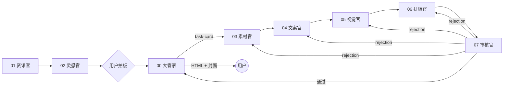
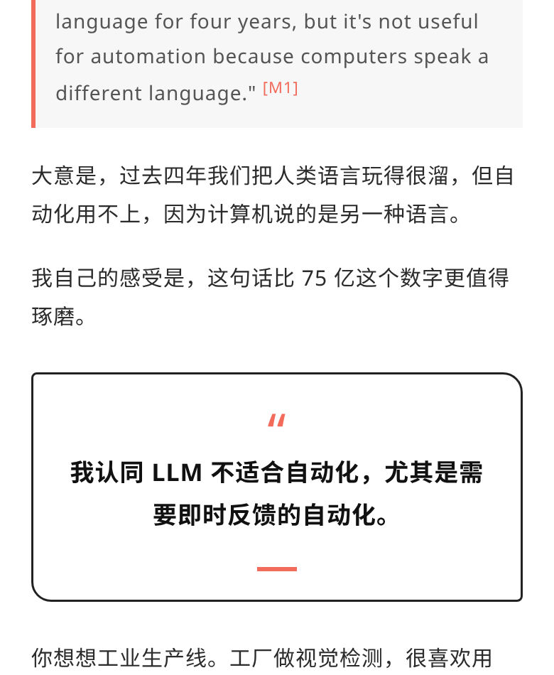
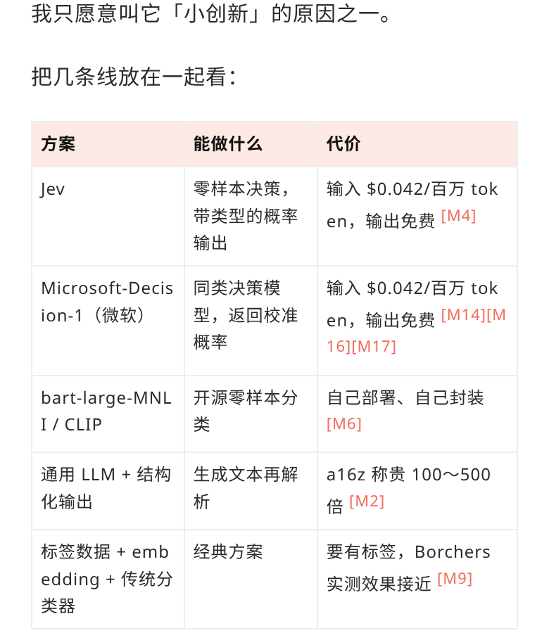
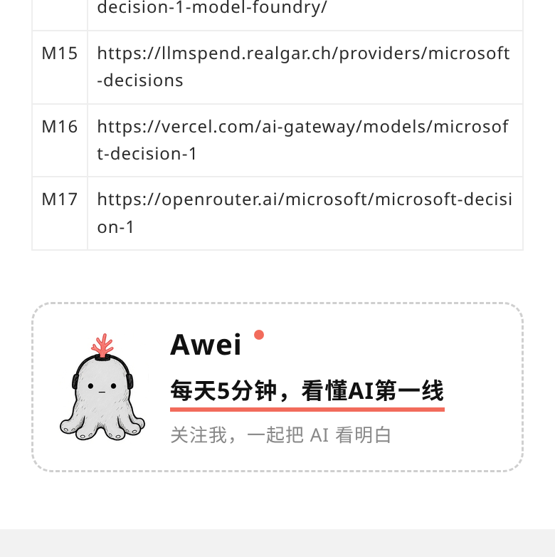
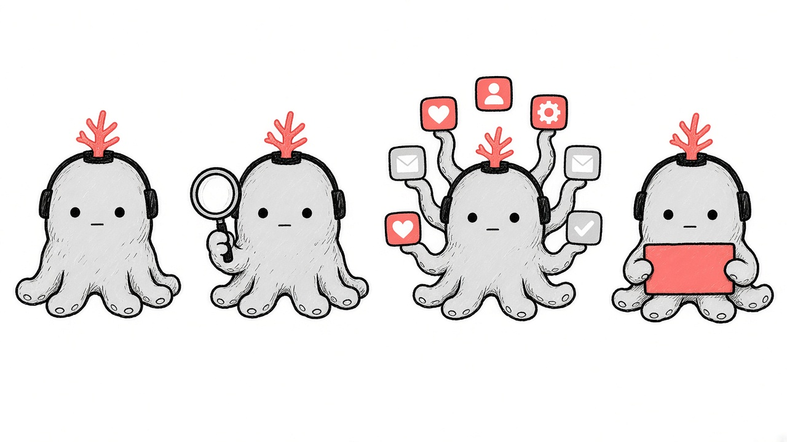
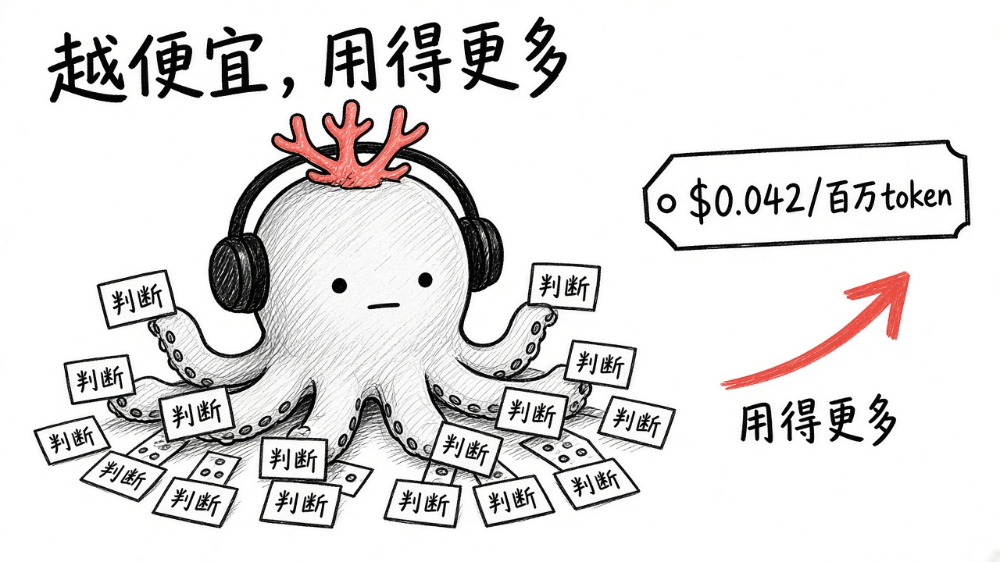

# gzh-article-group

中文 | [English](README.en.md)

一套**公众号文章多智能体工作流**，给 Codex、Cursor、Hermes、OpenClaw 等智能体直接装载使用。每个角色就是一个装载了固定 skill/spec 的 subagent，角色之间按 A2A（Agent2Agent）协议用三种消息通信：任务卡、交付、打回。分工固定，经验沉淀在各自的 `config/` 和 `projects/` 里。


## 流程


审核官不通过就用 rejection 打回负责角色，返工后重新验收；全部通过后，大管家只向用户交付两样：一份可直接粘贴进公众号的排版 HTML 和一张 2.35:1 封面。

## 目录
```
gzh-article-group/
├── AGENTS.md  CONVENTIONS.md  LICENSE  README.md  README.en.md
├── 00-chief-of-staff/   SKILL.md  spec.md  agent-card.json  config/  projects/
├── 01-news/             … config/news-sources.example.md
├── 02-ideation/
├── 03-research/
├── 04-copywriter/       … config/writing-style-outline.md
├── 05-visual/           … config/visual-style.md  config/ip/
├── 06-layout/           … config/master/  config/styles/
├── 07-reviewer/         … config/checklist.md
├── protocol/            task-card / delivery / rejection / handoff schemas + examples/
├── templates/project/
├── scripts/new-project.py
└── docs/showcase/
```
智能体请先读 [AGENTS.md](AGENTS.md) 和 [CONVENTIONS.md](CONVENTIONS.md)。

## 角色
| 目录 | 角色 | 职责 |
|---|---|---|
| [00-chief-of-staff](00-chief-of-staff/SKILL.md) | 大管家 | 编排者与用户主入口：派任务卡、汇总问题、交付 HTML + 封面 |
| [01-news](01-news/SKILL.md) | 资讯官 | 每个工作日整理 AI 热点早报 |
| [02-ideation](02-ideation/SKILL.md) | 灵感官 | 接住口喷、追问深挖、收敛成选题 |
| [03-research](03-research/SKILL.md) | 素材官 | 为选题搜集可核实素材与截图 |
| [04-copywriter](04-copywriter/SKILL.md) | 文案官 | 按作者风格写成稿 |
| [05-visual](05-visual/SKILL.md) | 视觉官 | 出风格统一的封面与配图 |
| [06-layout](06-layout/SKILL.md) | 排版官 | 把定稿、配图、截图排成可粘贴进公众号的 HTML |
| [07-reviewer](07-reviewer/SKILL.md) | 审核官 | 交付前最终验收，不过就打回 |

## A2A 消息示例
审核官打回排版官（[rejection.schema.json](protocol/rejection.schema.json)）：
```json
{
  "type": "rejection",
  "id": "rj-001",
  "project": "2026-10-12-jev-valuation",
  "from": "07-reviewer",
  "to": "06-layout",
  "item": "layout",
  "issues": [
    {
      "location": "文末卡片",
      "problem": "粘贴进公众号后章鱼图被放大",
      "expected": "img 写死 width 属性并缩小原图"
    }
  ]
}
```
三种消息说明见 [protocol/README.md](protocol/README.md)。

## 快速开始
1. 新开一篇文章：`python3 scripts/new-project.py 2026-10-20-my-topic`，会在 8 个角色目录下创建同名项目文件夹并初始化 `handoff.json`。
2. 按需替换配置：`01-news/config/news-sources.example.md`、`04-copywriter/config/writing-style-outline.md`、`05-visual/config/visual-style.md`。
3. 装载角色（以文案官为例）：
- **Codex**：在仓库根目录运行，Codex 会自动读取 `AGENTS.md`；再在提示里写「按 `04-copywriter/SKILL.md` 担任文案官，处理项目 `<slug>`」。也可把 `04-copywriter/` 拷到 `~/.codex/skills/gzh-copywriter/`，以 skill 形式加载。
- **Cursor**：打开仓库，在 `.cursor/rules/` 新建 `copywriter.mdc`，内容引用 `@04-copywriter/SKILL.md` 与 `@AGENTS.md`；或在 Chat 中直接 `@04-copywriter/SKILL.md` 后下达任务。
- **Hermes**：把 `04-copywriter/` 复制到 Hermes 的 skills 目录（如 `~/.hermes/skills/gzh-copywriter/`），SKILL.md 的 frontmatter 会被识别为技能名与描述。
- **OpenClaw**：把 `04-copywriter/` 放进工作区的 `skills/` 目录（如 `~/.openclaw/skills/gzh-copywriter/`），重启会话后按名称 `gzh-copywriter` 调用。

## 展示
| 片段 | 说明 |
|---|---|
|  | 标题与导语卡 |
|  | 金句卡与重点句高亮 |
|  | 对比卡 |
|  | 截图引用与来源标注 |
|  | 对比表 |
|  | 引用清单与代码排版文末卡片 |

IP 形象「灰章鱼」与配图：




## 全链路示例：Jev 估值 75 亿美元，是分类器换皮还是真创新？
项目 slug：`2026-10-12-jev-valuation`
1. [02-ideation](02-ideation/projects/2026-10-12-jev-valuation/topic.md) — 选题总结：核心观点「小创新」
2. [03-research](03-research/projects/2026-10-12-jev-valuation/materials.md) — 素材包（M1… 编号、带链接）
3. [04-copywriter](04-copywriter/projects/2026-10-12-jev-valuation/draft.md) — 定稿片段
4. [05-visual](05-visual/projects/2026-10-12-jev-valuation/cover-2.35.jpg) — 2.35:1 封面与配图
5. [06-layout](06-layout/projects/2026-10-12-jev-valuation/README.md) — 排版片段
6. [07-reviewer](07-reviewer/projects/2026-10-12-jev-valuation/review-report.md) — 验收报告（含打回记录）
7. [00-chief-of-staff](00-chief-of-staff/projects/2026-10-12-jev-valuation/delivery.md) — 交付清单

## 许可
[MIT](LICENSE)
